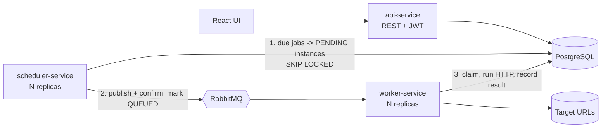

# Chronos: Distributed Job Scheduler

[](https://github.com/Ajay9760/Job-Scheduler/actions/workflows/ci.yml)
   

Chronos schedules HTTP calls (webhooks) on a cron, fixed-interval or one-time schedule, executes them on a pool of
workers, retries failures with exponential backoff, and exposes the results through a REST API and a React dashboard.
It is a learning project built to explore reliable distributed work processing; it has **not** been run in production.

## Contents
[Features](#features) · [Architecture](#architecture) · [Reliability guarantees](#reliability-guarantees) · [Security](#security) ·
[Quick start](#quick-start-docker) · [Local development](#local-development) · [Configuration](#configuration) · [API](#api) ·
[Testing](#testing) · [Load testing and scaling](#load-testing-and-scaling) · [Project layout](#project-layout) · [Limitations](#known-limitations)

## Features
- Cron (5 or 6 field, per-job timezone), interval and one-time schedules
- Per-job HTTP method, headers, body, timeout, priority, max retries and backoff
- Durable retries with exponential backoff (a retry is just a future-dated row, so it survives restarts)
- Run history, logs and per-job statistics; manual trigger, pause/resume, manual retry
- Per-target-host circuit breaker (defers runs instead of dropping them) and optional completion webhook
- Horizontally scalable scheduler and worker tiers; Prometheus metrics; Flyway-managed schema

## Architecture



| Module | Responsibility |
|---|---|
| `chronos-common` | Entities, repositories, Flyway schema (single owner), lifecycle service, schedule calculator, SSRF guard, messaging topology |
| `api-service` | Auth, owner-scoped job/instance/log/statistics endpoints |
| `scheduler-service` | Trigger (due jobs to instances), dispatcher (outbox to RabbitMQ), reaper and retention |
| `worker-service` | RabbitMQ consumer, HTTP executor, circuit breaker, webhook notifier |
| `ui` | React + Vite dashboard |

## Reliability guarantees
- **Transactional outbox:** the `job_instances` row *is* the outbox (`PENDING` to `QUEUED`). A job is never lost between the database and the broker.
- **No double scheduling:** `SELECT ... FOR UPDATE SKIP LOCKED` gives each due job and pending instance to exactly one scheduler replica. No leader election or Redis lock.
- **Effectively-once execution:** delivery is at-least-once, and workers claim an instance with an atomic conditional UPDATE (`PENDING|QUEUED` to `RUNNING`), so duplicate deliveries are no-ops.
- **Self-healing:** a reaper fails instances stuck in `RUNNING` and re-queues stale `QUEUED` ones.
- **No lost updates:** statistics use atomic SQL counters; job edits use optimistic locking.
- **Time:** everything is stored as UTC `TIMESTAMPTZ`; missed runs fire once, not as a backlog replay.

These are proven by integration tests against real PostgreSQL (see [Testing](#testing)).

## Security
- JWT (HS256) with a secret from the environment (32+ characters enforced), configurable expiry, and token versioning for "log out everywhere"
- BCrypt passwords; registration always creates a normal user; the optional admin is bootstrapped from environment variables
- Every job, instance and log endpoint is scoped to the authenticated owner
- **SSRF protection:** only http/https, no credentials in URLs, private/loopback/link-local (e.g. cloud metadata) targets blocked at creation and again before each call; redirects are not followed
- Per-job request timeout and a 64 KB response cap

## Quick start (Docker)

Requirements: Docker with Compose v2.

```bash
git clone https://github.com/Ajay9760/Job-Scheduler.git
cd Job-Scheduler
cp .env.example .env          # Windows: copy .env.example .env
```
Edit `.env`: set `DB_PASSWORD`, `RABBIT_PASSWORD` and a `JWT_SECRET` of 32+ random characters
(`openssl rand -base64 48`, or in PowerShell: `[Convert]::ToBase64String((1..48 | % { Get-Random -Max 256 }))`).

```bash
docker compose up --build
```

| Service | URL |
|---|---|
| API | http://localhost:8080 |
| RabbitMQ management | not exposed by default (add `ports: ["15672:15672"]`, or use the bench overlay) |

First build downloads dependencies and can take several minutes; later builds reuse the Maven cache. Scale replicas with
`docker compose up --scale scheduler=2 --scale worker=4`.

**Try it:**
```bash
TOKEN=$(curl -s -X POST localhost:8080/api/auth/register -H 'Content-Type: application/json' \
  -d '{"username":"demo","password":"demo-password-123"}' | sed 's/.*"token":"\([^"]*\)".*/\1/')

curl -X POST localhost:8080/api/jobs -H "Authorization: Bearer $TOKEN" -H 'Content-Type: application/json' -d '{
  "name":"ping","targetUrl":"https://example.com","httpMethod":"GET",
  "scheduleType":"CRON","cronExpression":"*/1 * * * *","timezone":"UTC"}'
```
To target `localhost` or private IPs during development, set `ALLOW_PRIVATE_TARGETS=true` in `.env` (never in production).

## Local development
Requirements: JDK 21, Maven 3.9+, Node 22+, Docker (for tests and infrastructure).

```bash
docker compose up -d postgres rabbitmq     # infrastructure only (add `ports:` mappings for 5432/5672 in an override file)
export DB_PASSWORD=... RABBIT_PASSWORD=... JWT_SECRET=...   # same values as the containers
mvn clean verify                           # build + all tests
mvn -pl api-service spring-boot:run        # likewise scheduler-service (8081) and worker-service (8082)
cd ui && npm ci && npm run dev             # http://localhost:5173 (API base: VITE_API_BASE, default http://localhost:8080/api)
```

## Configuration
All settings are environment variables (see `.env.example` and each `application.properties`).

| Variable | Default | Purpose |
|---|---|---|
| `DB_URL`, `DB_USERNAME`, `DB_PASSWORD` | local Postgres | Database (all services share one schema, owned by Flyway) |
| `RABBIT_HOST`, `RABBIT_USERNAME`, `RABBIT_PASSWORD` | localhost | Broker |
| `JWT_SECRET` | none (required) | 32+ chars; the API refuses to start without it |
| `ADMIN_USERNAME`, `ADMIN_PASSWORD` | empty | Creates an admin on first start (password 12+ chars) |
| `ALLOW_PRIVATE_TARGETS` | `false` | Allow jobs to call private/loopback addresses (dev only) |
| `WORKER_CONCURRENCY`, `WORKER_MAX_CONCURRENCY`, `WORKER_PREFETCH` | 4 / 8 / 10 | Threads and prefetch per worker replica |
| `DB_POOL_SIZE` | 10 | Hikari pool per service |
| `CHRONOS_RETENTION_DAYS` | 30 | Age at which terminal instances and logs are deleted |
| `CHRONOS_SCHEDULER_BATCH_SIZE` | 100 | Rows locked per trigger/dispatch batch |

## API
All endpoints are under `/api` and need `Authorization: Bearer <token>` except register and login.

| Area | Endpoints |
|---|---|
| Auth | `POST /auth/register`, `POST /auth/login`, `POST /auth/logout-all` |
| Jobs | `POST/GET /jobs`, `GET/PUT/DELETE /jobs/{id}`, `POST /jobs/{id}/trigger\|pause\|resume`, `GET /jobs/{id}/instances` |
| Instances | `GET /instances/{id}`, `GET /instances/job/{jobId}`, `POST /jobs/instances/{id}/retry` |
| Logs | `GET /logs`, `GET /logs/instance/{id}` |
| Analytics | `GET /statistics/job/{id}`, `GET /analytics/status-counts`, `GET /analytics/instance-status-counts` |

Errors use one JSON shape (`timestamp, status, error, message, fields`). Metrics: `/actuator/prometheus` on each service.

## Testing
```bash
mvn clean verify        # needs Docker running (Testcontainers starts PostgreSQL)
```
- **Concurrency integration tests (real PostgreSQL):** exactly-one claim under 16 competing threads, disjoint `SKIP LOCKED` batches for concurrent schedulers and dispatchers, no lost counter updates under 50 concurrent completions, duplicate-result handling, durable retry with backoff.
- **Executor tests (local HTTP server):** success, non-2xx, timeout, no redirects, response cap, SSRF block.
- **Unit tests:** schedule calculation (cron, timezone, interval, once), URL validation, JWT, circuit breaker.

CI (`.github/workflows/ci.yml`) runs the Maven build and the UI build on every push and pull request.

## Load testing and scaling
- `./bench/run.sh 50000 2 4` (Windows: `.\bench\run.ps1 -N 50000 -Schedulers 2 -Workers 4`) seeds due jobs against a local HTTP target and reports throughput, queue-wait p50/p95/p99, execution time and exactly-once checks.
- `bench/k6/api-load.js` load-tests the REST API.
- How each tier scales, where the ceiling is, and a results table to fill with **your own measured numbers**: [docs/SCALING.md](docs/SCALING.md).

## Project layout
```
chronos-common/     shared domain, repositories, Flyway migrations, lifecycle logic
api-service/        REST API and security
scheduler-service/  trigger, dispatcher, reaper, retention
worker-service/     consumer, HTTP executor, circuit breaker
ui/                 React dashboard
bench/              load-test scripts (seed/report SQL, k6, runners)
docs/SCALING.md     scaling notes and benchmark results
docker-compose.yml  full stack; docker-compose.bench.yml adds a load-test overlay
```

## Known limitations
- PostgreSQL is a single writer and the first bottleneck; see `docs/SCALING.md` for partitioning, PgBouncer and sharding as next steps.
- Execution is at-least-once: if a worker dies after calling the target but before recording the result, the run is repeated. Targets should be idempotent.
- Only HTTP(S) targets are supported; no DAGs or job dependencies; single tenant-per-user model with no quotas.
- Performance figures are not published here until measured; run the benchmark and record your own.

## License
No license has been specified yet; all rights reserved by the author until one is added.
